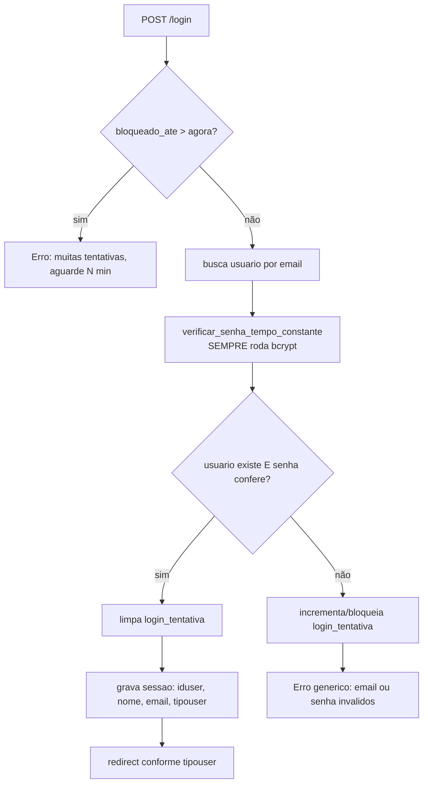

# Fluxos do Login

## 1. `GET /login` — exibir formulário

```
usuário acessa /login
  → se método GET: renderiza login.html com erro=None
  → campos de e-mail/senha chegam vazios (JS força isso no load, mesmo com autofill do navegador)
```

## 2. `POST /login` — submissão de credenciais

```
1. lê email e senha do form
2. consulta tempo_restante_bloqueio(email) na tabela login_tentativa
   ├─ bloqueado (retornou minutos > 0)?
   │    → erro = "Muitas tentativas de login. Tente novamente em N minuto(s)."
   │    → NÃO consulta usuário, NÃO roda bcrypt
   │    → renderiza login.html com erro
   │
   └─ não bloqueado:
        3. busca usuario = buscar_usuario_por_email(email)
        4. senha_hash = usuario["senha"] se usuario existe, senão None
        5. senha_confere = verificar_senha_tempo_constante(senha, senha_hash)
           (SEMPRE roda bcrypt, mesmo se usuario for None — ver 03-seguranca.md)
        6. usuario existe E senha_confere?
           ├─ SIM:
           │    → registrar_login_sucesso(email)  [limpa login_tentativa]
           │    → session["usuario"] = {iduser, nome, email, tipouser}
           │    → redirect("/")
           │
           └─ NÃO:
                → registrar_login_falho(email)  [incrementa/reseta contador, pode bloquear]
                → erro = "E-mail ou senha inválidos."
                → renderiza login.html com erro
```

## 3. Lógica de `registrar_login_falho` (dentro do banco, uma query atômica)

```
UPSERT em login_tentativa por email:
  se não existe linha para o email → cria com tentativas=1
  se existe:
    se (agora - ultima_tentativa) > JANELA_MINUTOS (15 min)
        → tentativas = 1   (reinicia a janela)
    senão
        → tentativas = tentativas + 1

    sempre atualiza ultima_tentativa = agora

    se o novo valor de tentativas >= LIMITE_TENTATIVAS (5)
        → bloqueado_ate = agora + BLOQUEIO_MINUTOS (15 min)
    senão
        → bloqueado_ate permanece como estava
```

## 4. Lógica de `tempo_restante_bloqueio`

```
SELECT minutos restantes
FROM login_tentativa
WHERE email = :email AND bloqueado_ate > agora

→ se encontrou linha: retorna minutos (arredondado para cima)
→ se não encontrou (nunca bloqueado, ou bloqueio já expirou): retorna None
```

Observação: o bloqueio expira **sozinho** por comparação de data — não há job/cron para
"desbloquear"; a próxima tentativa depois do prazo simplesmente não encontra
`bloqueado_ate > NOW()` e segue o fluxo normal (que, se falhar de novo, reinicia o
contador em 1 porque a última tentativa já passou da janela de 15 min).

## 5. `GET /logout`

```
limpa toda a sessão (session.clear())
redirect("/login")
```

## 6. Roteamento pós-login e controle de acesso por perfil

```
GET /  (qualquer rota protegida por @login_required)
  → sem "usuario" na sessão?  → redirect("/login")
  → com sessão: lê tipouser e redireciona/permite conforme o mapa:
       ADM        → /admin
       PROFESSOR  → /professor
       ALUNO      → /aluno

Rotas específicas de perfil usam @role_required("ADM"/"PROFESSOR"/"ALUNO") além de
@login_required:
  → tipouser da sessão diferente do exigido → redirect("/")  (não é 403 explícito,
    é um redirecionamento silencioso de volta para a home do próprio usuário)
```

## 7. Diagrama (mermaid) — visão consolidada


